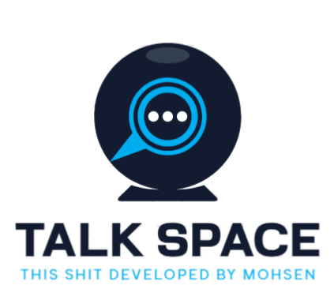

# Talk Space

Talk Space is a small Rust and WebAssembly demo for browser-to-browser video calls. The browser client captures local media and uses WebRTC for peer connections. A Rust WebSocket server assigns users to sessions and forwards WebRTC offers, answers, and ICE candidates.

<p align="center">
  
</p>

## What is implemented

- Browser client written in Rust, compiled to WebAssembly.
- Signalling server written in Rust, listening on TCP port `2794`.
- Create a session, share its ID, and join from another browser.
- Camera and microphone capture, SDP offer/answer exchange, and ICE candidate forwarding.
- A separate experimental TURN server crate.

The client currently starts a plain `RTCPeerConnection` with no configured ICE servers. STUN and TURN peer-connection helpers exist in the source but are not selected by the app entry point. The TURN server also contains example network addresses and credentials; see [TURN server notes](#turn-server) before attempting to use it. This repository is a prototype, not a production-ready calling service.

## Repository layout

| Path | Purpose |
|---|---|
| `client/` | Rust/WebAssembly browser client, page, and Cargo Make tasks |
| `signalling-server/` | WebSocket signalling server and run/build tasks |
| `shared-protocol/` | Message types shared by the client and server |
| `turn-server/` | Experimental TURN server |

## Requirements

- Rust toolchain and Cargo
- `cargo-make` (`cargo install cargo-make` if it is not installed)
- The `wasm32-unknown-unknown` Rust target (`rustup target add wasm32-unknown-unknown`)
- A modern browser with camera and microphone access

The client Cargo Make tasks install `wasm-pack` and `microserver` when needed.

## Run locally

Open two terminals from the repository root.

**Terminal 1: build and serve the browser client**

```sh
cd client
cargo make build
cargo make serve
```

Open the local URL printed by `microserver` (the configured port is `9000`). For automatic rebuilds while editing, use `cargo make watch` instead of `cargo make build`; it watches and rebuilds the client but does not start the web server. Run `cargo make serve` in another terminal to serve the page.

**Terminal 2: run the signalling server**

```sh
cd signalling-server
cargo make servesignal
```

The signalling server listens on `0.0.0.0:2794` and logs to `signalling_server_prototype.log` in its working directory.

### Configure the WebSocket address

Before opening the client, set `WS_IP_PORT` in `client/src/websockets.rs` to an address reachable from the browser:

```rust
const WS_IP_PORT: &str = "ws://127.0.0.1:2794";
```

Use `127.0.0.1` when the browser and signalling server run on the same computer. For another device on your local network, use the server computer's private/LAN IP address. For clients connecting over the internet, use the server's public IP or hostname and configure routing/firewall access to port `2794`.

The current signalling server serves plain `ws://` and does not configure TLS. If the web page is served over HTTPS, browsers generally require a secure `wss://` WebSocket; put the signalling server behind a TLS-terminating reverse proxy and point `WS_IP_PORT` at that proxy.

### Make a call

1. Open the client page in two browser tabs or on two devices that can reach the signalling server.
2. In the first client, select **Start Session** and share the displayed session ID.
3. In the second client, enter that ID and select **Connect to Session**.
4. Allow camera and microphone access when prompted.

The page includes buttons for printing client and signalling-server state to help with debugging. The signalling-state button writes to the server terminal.

## TURN server

The `turn-server/` crate is separate from the default call flow. Its current source contains hard-coded private IP addresses (`192.168.178.60`), sample `userN` / `passN` credentials, and a configured UDP port (`3478`). These values must be replaced and the network/firewall/relay port range configured for the deployment environment. The client currently does not use this TURN configuration by default.

## Troubleshooting

| Symptom | Check |
|---|---|
| WebSocket connection fails | Confirm the signalling server is running, `WS_IP_PORT` is reachable from the browser, and port `2794` is allowed. |
| Camera or microphone is unavailable | Grant browser permission and use `localhost` or a secure page origin. |
| Session join fails | Check that the session ID was copied correctly and the host is still connected. |
| Signalling connects but media does not | Check ICE connectivity. The default client has no configured STUN/TURN servers; peers behind restrictive NATs may need ICE server configuration. |

## Security and limitations

- WebRTC encrypts media transport with DTLS-SRTP, but the signalling server has no user authentication or TLS configuration.
- Session IDs are short random identifiers and should not be treated as access credentials.
- The TURN source includes hard-coded example credentials and network addresses. Do not expose it publicly without replacing and securing them.
- The default client currently uses no STUN/TURN servers, so direct peer connectivity depends on the network path.
- HTTPS/WSS and authenticated signalling are needed before exposing a deployment to untrusted users.

## License

# This Shit Developed By MOHSEN